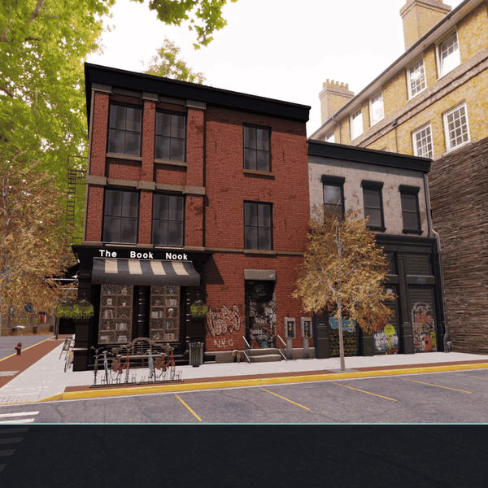
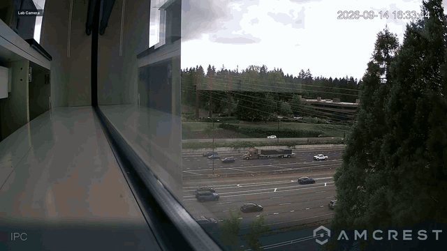
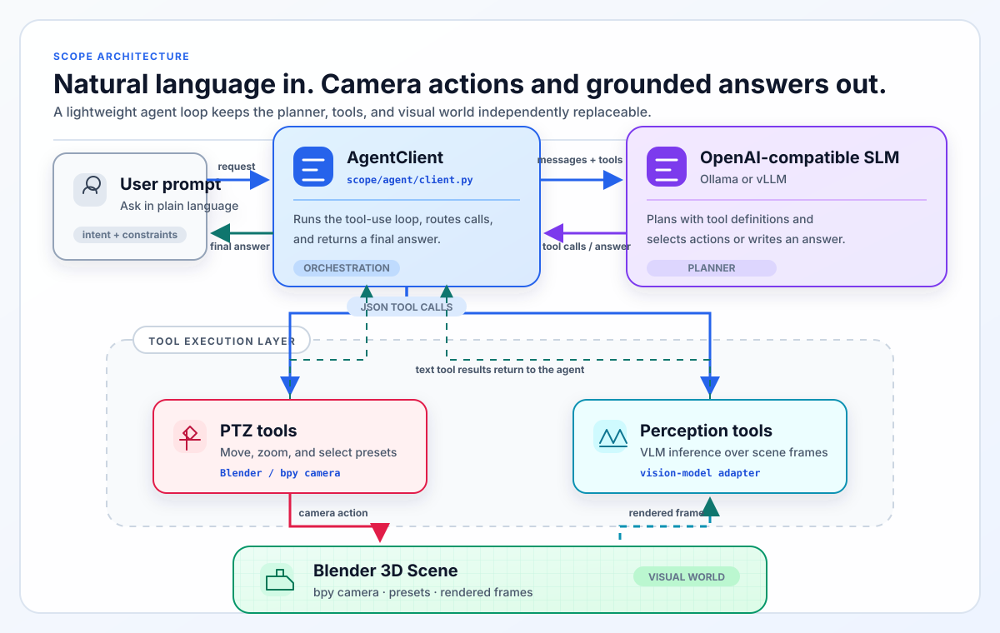
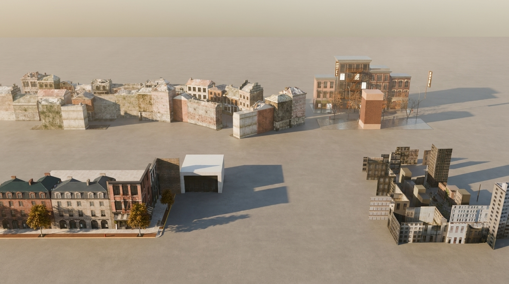
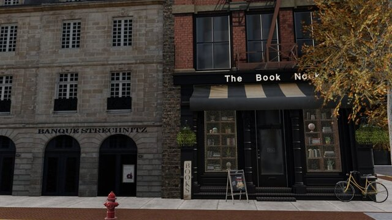
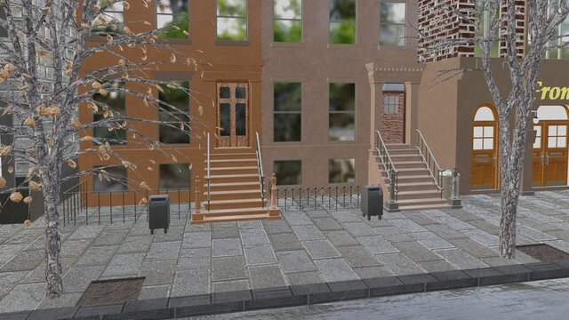
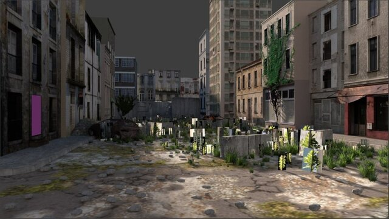
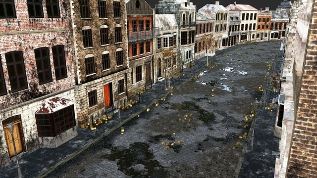
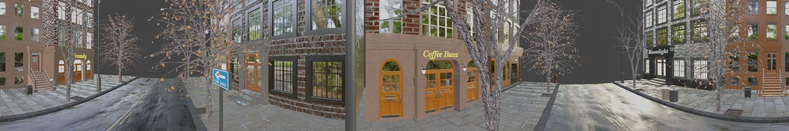

# SCOPE

**A Natural-Language PTZ Camera Agent That Runs Entirely at the Edge**

[](https://doi.org/10.1145/3757279.3785641)
[](https://arxiv.org/abs/2606.02951)
[](https://huggingface.co/datasets/HindsboNikolaj/scope-benchmark)
[](https://huggingface.co/spaces/HindsboNikolaj/scope)
[](https://huggingface.co/collections/HindsboNikolaj/scope-hri-26-6a1626e0b8e9b9205c09fffc)

SCOPE turns a plain-language camera request into a closed loop: a small language model plans,
vision-language tools inspect the scene, and PTZ tools act before the agent answers. It is a
modular multimodal agent designed for edge deployment and benchmarked through a reproducible
Blender digital twin; published at HRI 2026.

**Release 0.2.0** (November 2026): benchmark dataset v2 and its results under a three-judge panel,
a parallel benchmark launcher and GPU capture. The paper's numbers (0.1.0) are unchanged in
[`docs/PAPER_RESULTS.md`](docs/PAPER_RESULTS.md), and its original dataset is still available as
[`benchmark/archive/scope_536_v1.csv`](benchmark/archive/scope_536_v1.csv); we recommend dataset v2.

<table>
  <tr>
    <td width="38%" align="center" valign="middle"><a href="docs/media/scope-book-nook-tasks.mp4"></a></td>
    <td width="62%" align="center" valign="middle"><a href="docs/media/scope-real-camera.mp4"></a></td>
  </tr>
  <tr>
    <td valign="top"><strong>Book Nook: five benchmark tasks in one scene.</strong> Pan right then left, count the hanging plants, zoom in to read the shop sign, then go to a preset and zoom on the bank, in the Blender digital twin.</td>
    <td valign="top"><strong>SCOPE driving the office PTZ cameras (research demonstration).</strong> An operator reports a car in the south car park; SCOPE switches cameras, finds the white car, zooms in and reads the plate (redacted).</td>
  </tr>
</table>

## How it works



[`AgentClient`](src/scope/agent/client.py) sends the tool definitions in
[`schema.json`](src/scope/tools/schema.json) to the planner over an OpenAI-compatible
tool-calling API, runs each tool call and returns its text result, until the planner answers.
Perception tools call the vision model only when needed and return short text (a count, a reading,
a location) instead of putting images in every planner turn, so planner, perception and camera
control can be swapped and measured separately.

| Tool family | Tools | In Blender |
| --- | --- | --- |
| Camera control | `ptz_adjust`, `go_to_preset`, `home_action`, `get_presets`, `take_image` | Moves the scene camera, selects a preset, or captures the camera view |
| Perception | `count_pointing`, `query_answer`, `zoom_bounding` | Captures a frame or panorama and asks the vision model |
| Tracking | `track_object` | A stub in simulation |

Perception sees exactly the camera's view: [`screenshot_camera_view`](src/scope/blender/helper_funcs.py)
crops a viewport capture to the camera frame. To add a tool, start with
[`examples/add_new_tool.py`](examples/add_new_tool.py), then add its schema to `schema.json` and
its function to [`blender_tools.py`](src/scope/tools/blender_tools.py). More in
[`docs/architecture.md`](docs/architecture.md) (including adapters for MCP, other runtimes and physical
cameras) and [`docs/tool_reference.md`](docs/tool_reference.md).

## Results

<details>
<summary><b>See full results on all model pairs (v0.2.0, October 2026)</b></summary>

Dataset v2, all 536 tasks; a task passes when two of three judges agree.

| Planner | Vision model | Accuracy |
| --- | --- | :---: |
| Qwen3.8-27B | Qwen3.6-35B-A3B | 81.5% |
| Qwen3.8-27B | Qwen3.8-27B-AWQ-INT4 | 81.3% |
| Muse-Glimmer-30B+DFlash2 | Moondream 3.1 | 80.4% |
| Qwen3.8-27B | gemma-4-26B-A4B-it | 80.0% |
| Qwen3.8-27B | Molmo2-8B | 79.9% |
| Muse-Glimmer-30B | Moondream 3.1 | 79.7% |
| Qwen3.8-27B-AWQ-INT4 | Moondream 3.1 | 78.7% |
| gemma-4-26B-A4B-it | Moondream 3.1 | 78.5% |
| Qwen3.8-27B | Moondream 3.1 | 78.4% |
| gpt-oss-120b | Moondream 3.1 | 78.2% |
| gemma-4-12B-it | Moondream 3.1 | 78.2% |
| Qwen3.8-27B+DFlash2 | Moondream 3.1 | 78.0% |
| gemma-4-26B-A4B-it | same model (one server) | 77.6% |
| Qwen3-Next-80B-A3B | Moondream 3.1 | 76.9% |
| Qwen3.8-27B | Moondream2 | 76.7% |
| Qwen3.8-27B | same model (one server) | 76.1% |
| gpt-oss-20b | Moondream 3.1 | 75.9% |
| Qwen3.6-35B-A3B | Moondream 3.1 | 74.1% |
| gemma-4-E4B-it | Moondream 3.1 | 69.0% |
| Qwen3-8B+EAGLE3 | Moondream 3.1 | 68.3% |
| Qwen3-8B+DSpark | Moondream 3.1 | 67.7% |
| Qwen3-8B | Moondream 3.1 | 65.5% |
| Qwen3-4B | Moondream 3.1 | 62.5% |
| Qwen3-30B-A3B (base checkpoint, /no_think) | Moondream 3.1 | 60.1% |
| Qwen3.8-27B | Molmo2-VideoPoint-4B | 56.9% |
| Qwen3.5-0.8B | Moondream 3.1 | 41.6% |

</details>

<details>
<summary><b>Paper results (v0.1.0, November 2025)</b></summary>

Dataset v1, as published in the HRI 2026 paper: one judge (gpt-oss-120B), mean of eight category accuracies.

| Planner | Vision model | Accuracy |
| --- | --- | :---: |
| Qwen3-30B-A3B | Moondream3 | 73.8% |
| Qwen3-Next-80B-A3B | Moondream2 | 70.6% |
| Qwen3-30B-A3B-FP8 | Moondream2 | 69.6% |
| Qwen3-Next-80B-A3B | Moondream3 | 69.3% |
| Qwen3-30B-A3B-FP8 | Moondream3 | 69.1% |
| Qwen3-32B | Moondream3 | 68.8% |
| Qwen3-Next-80B-A3B | Qwen2.5-VL-7B | 68.3% |
| Qwen3-32B | Moondream2 | 68.0% |
| Qwen3-30B-A3B | Moondream2 | 67.3% |
| Qwen3-30B-A3B | Moondream2-4bit | 66.9% |
| Qwen3-Next-80B-A3B | Moondream2-4bit | 66.8% |
| Qwen3-32B | Moondream2-4bit | 65.9% |
| Qwen3-30B-A3B-FP8 | Moondream2-4bit | 65.7% |
| Qwen3-4B-FP8 | Moondream3 | 62.6% |
| Qwen3-4B | Moondream2-4bit | 62.3% |
| Qwen3-4B | Moondream3 | 61.4% |
| Qwen3-4B-FP8 | Moondream2-4bit | 61.3% |
| Qwen3-4B-FP8 | Moondream2 | 60.3% |
| Qwen3-4B | Moondream2 | 59.7% |

</details>

All results, with notes on each run and the paper's dataset graded again after release:
[`docs/RESULTS.md`](docs/RESULTS.md).

## The benchmark worlds

[](docs/images/worlds/four-worlds-render.jpg)

*Enhanced illustration of the four benchmark worlds.*

**Real renders:**

<table>
  <tr>
    <td width="50%"><br /><b>book-nook</b>: a bookshop, a bank and parked bikes. 170 tasks.</td>
    <td width="50%"><br /><b>city-street</b>: brownstones, a café and a hotel. 120 tasks.</td>
  </tr>
  <tr>
    <td width="50%"><br /><b>postwar-city</b>: ruined blocks, seen from the street and from above. 109 tasks.</td>
    <td width="50%"><br /><b>whitechapel</b>: a Victorian brick street. 137 tasks.</td>
  </tr>
</table>



**A full view** (city-street, `mailbox`): the stitched 360° view the vision tools answer from
when the planner asks for `view_type: "full"`; 89 of the 536 tasks need it. How each viewpoint's
full view is chosen: [`docs/FULL_VIEW.md`](docs/FULL_VIEW.md).

## Run the benchmark

You need Python 3.10+, a planner endpoint with tool calling, a vision model and a judge
endpoint. This serial setup also needs Blender 4.0+ on the host (set `BLENDER_BIN` if `blender`
is not on your PATH); the GPU Docker workflow below runs Blender in its image instead. Run from
the repository root:

```bash
python3 -m venv .venv && source .venv/bin/activate
bash scripts/01_install.sh                        # SCOPE, and the runner's packages in Blender's Python
python scripts/install_blender_deps.py --check    # prints OK when Blender's Python is ready
bash scripts/02_pull_models.sh                    # default models: gemma-4-26B-A4B-it and its vLLM image
# Start the model server (docs/CONFIGURATION.md), then set the judge (JUDGE_*) in .env.
set -a; source .env; set +a
bash scripts/03_download_scenes.sh                # the four worlds, from Hugging Face
"${BLENDER_BIN:-blender}" --background --python scripts/04_install_presets.py
QUESTIONS_CSV=benchmark/scope_v2_smoke.csv SCOPE_RESUME=0 bash scripts/run_eval_pipeline.sh  # 24 tasks
```

The smoke set, [`benchmark/scope_v2_smoke.csv`](benchmark/scope_v2_smoke.csv), is 24 v2 tasks:
three per category, six per world, picked by a fixed rule from the dataset alone
([`scripts/make_smoke_set.py`](scripts/make_smoke_set.py)). The default setup passed 21 of 24 in
v2 (`tB08`, three-judge panel) and its repeat run 19 of 24, so a working install lands near
there. Every v2 run's per-task verdicts are in
[`per-task.csv`](benchmark/results/v2-2026-10/per-task.csv) for a task-by-task comparison.

To grade like v2, set the three judge endpoints (`PANEL_*` in `.env`) and run `scripts/13_judge_panel.py` ([`docs/JUDGING.md`](docs/JUDGING.md#3-the-v2-judge-panel)).

Default models: gemma-4-26B-A4B-it as both planner and vision model, one server (77.6% in v2). Other
measured setups: [`docs/CONFIGURATION.md`](docs/CONFIGURATION.md#measured-recipes-dataset-v2).

The evaluator opens Blender with a UI because capture needs a 3D viewport; on a server without a
display see [`docs/HEADLESS.md`](docs/HEADLESS.md). For agent-assisted setup, give
[`AGENT_INSTRUCTIONS.md`](AGENT_INSTRUCTIONS.md) to Claude Code or Codex.

**On a GPU server** (Linux, Docker, NVIDIA GPU access), `scripts/run_fast.py` runs one pairing
as six Blender workers (two each for book-nook and city-street), each keeping its world loaded
and capturing on the GPU. Start the planner and vision servers first; `--gpu` picks the capture
card. The default Gemma server can share that card with two workers (`--workers 2`); six workers
want a card of their own. The planner and vision settings come from `.env`. Host Blender is not
needed: the Blender check and camera presets can run in the image
([`docs/RUN_FAST.md`](docs/RUN_FAST.md#prerequisites)). `run_fast.py` takes the presets from that
in-image install (`.scope-presets/`) when it exists, else from host Blender 4.4's presets folder;
it prints the folder it used and stops if a preset the tasks need is missing.

```bash
export SCOPE_GPU_DEVICE=0 SCOPE_CONTAINER_PREFIX=scope   # capture card, container names (defaults)
docker build -t scope-blender:4.4.3 docker/        # base image, once
bash docker/build-gpu.sh                            # GPU drawing on top of it
set -a; source .env; set +a
# Sharing card 0 with the model server: --workers 2. Capture on a free card: six workers (default).
python3 scripts/run_fast.py --questions benchmark/scope_v2_smoke.csv --workers 2 --out results/smoke --judge
python3 scripts/run_fast.py --workers 2 --out results/my-pairing --judge   # all 536 tasks
```

Re-run the same command to resume. `--dataset v1` runs the paper's tasks; `--dry-run` prints the
plan. Details: [`docs/RUN_FAST.md`](docs/RUN_FAST.md).

Answering time with the models already loaded; 0.2.0 ran `run_fast.py` with six workers on one card
and the planner and vision models on two more (judging and setup excluded).

| Measured on A100 80GB GPUs | 0.1.0 | 0.2.0 |
| --- | :---: | :---: |
| Entire dataset (536 tasks), Qwen3.8-27B + Moondream 3.1 | 157 min | 30 min |
| One capture | 14.6 s | 0.2 s |
| Server with no display | Could not finish a task | Runs ([`docs/HEADLESS.md`](docs/HEADLESS.md)) |

Without a GPU server, the serial pipeline runs one Blender process:
`bash scripts/run_eval_pipeline.sh` (options in [`AGENT_INSTRUCTIONS.md`](AGENT_INSTRUCTIONS.md#serial-pipeline-options)).

## Dataset versions

| Version | File | Rows | Use |
| --- | --- | ---: | --- |
| **v2** (default) | [`benchmark/scope_v2.csv`](benchmark/scope_v2.csv) | 536 | v1 plus [corrections](benchmark/CHANGES_v2.md) |
| v1 | [`benchmark/archive/scope_536_v1.csv`](benchmark/archive/scope_536_v1.csv) | 536 | The paper's tasks: `--dataset v1` or `SCOPE_DATASET=v1` |

Every script reads the benchmark CSV from this repository. The
[Hugging Face dataset](https://huggingface.co/datasets/HindsboNikolaj/scope-benchmark) is mainly
the download for the four Blender worlds; `scripts/03_download_scenes.sh` fetches only its
`scenes/`. How the 0.1.0 file became v1: [`benchmark/archive/`](benchmark/archive/README.md).

## Repository layout

| Path | Contents |
| --- | --- |
| [`src/scope/`](src/scope/) | Agent loop, tools, vision clients, Blender helpers, runner and judge |
| [`benchmark/`](benchmark/) | Dataset v2, its corrections and change list, the archived v1, results tables, camera presets and panoramas |
| [`scripts/`](scripts/) | Install, scene download, the benchmark launchers, judge, judge panel and metrics |
| [`prompts/`](prompts/) | Planner system prompt and judge prompts |
| [`configs/`](configs/) | Planner and vision configurations |
| [`docker/`](docker/) | Blender images, including the GPU capture image |
| [`examples/`](examples/) | Quick start, custom model and custom tool |
| [`docs/`](docs/) | Results, judging, setup, headless and GPU capture, scenes, architecture |
| [`tests/`](tests/) | CPU tests (`pytest`, no Blender needed) |

## Citation

```bibtex
@inproceedings{Armada2026SCOPE,
  title         = {SCOPE: A Real-Time Natural Language Camera Agent at the Edge:
                   A Sim-to-Real Benchmark and Analysis of Open-Source Vision
                   and Language Agents for PTZ Camera Tasks},
  author        = {Hindsbo, Nikolaj and Ehsani, Sina and Mishra, Pragyana},
  booktitle     = {Proceedings of the ACM/IEEE International Conference on
                   Human-Robot Interaction (HRI '26)},
  year          = {2026},
  publisher     = {ACM},
  doi           = {10.1145/3757279.3785641},
  eprint        = {2606.02951},
  archivePrefix = {arXiv},
  primaryClass  = {cs.RO},
}
```

## Credits

- city-street: "City Street" by amaryase, BlendSwap #30474, CC-BY.

## License

MIT for the code; see [LICENSE](LICENSE). Scene assets keep their original licences.
